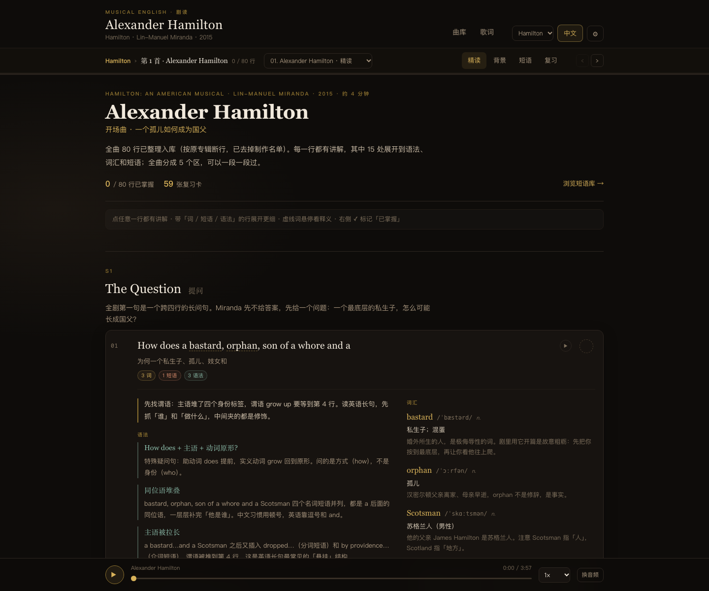
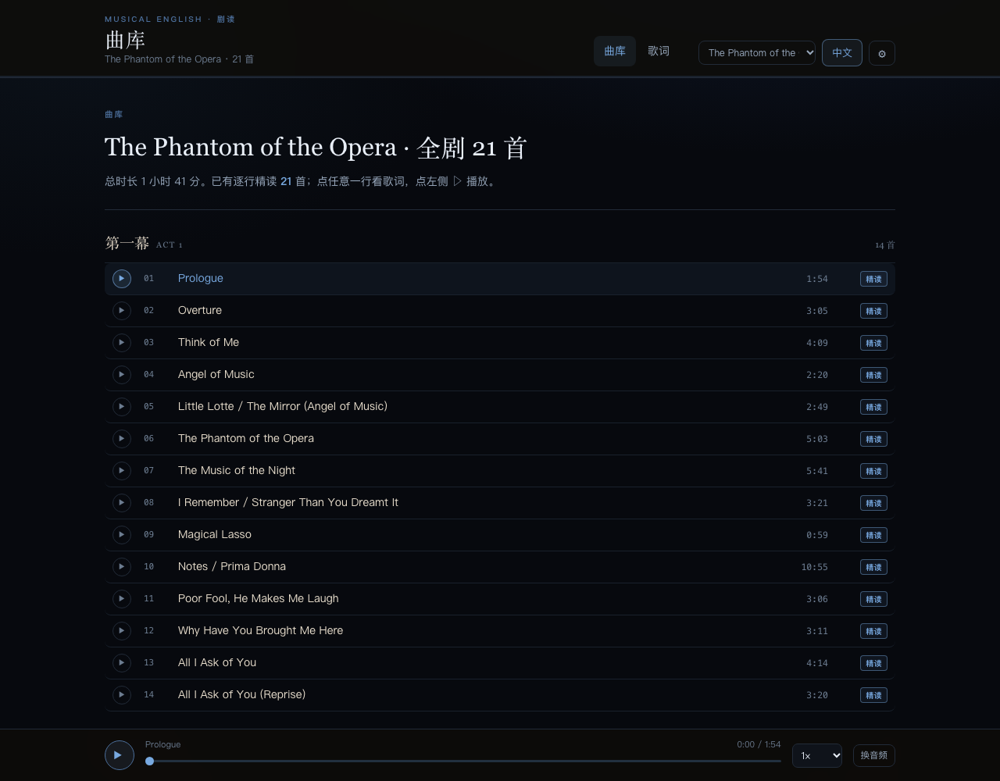
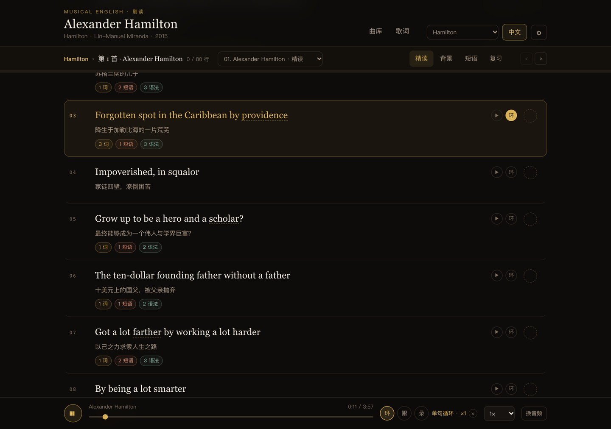
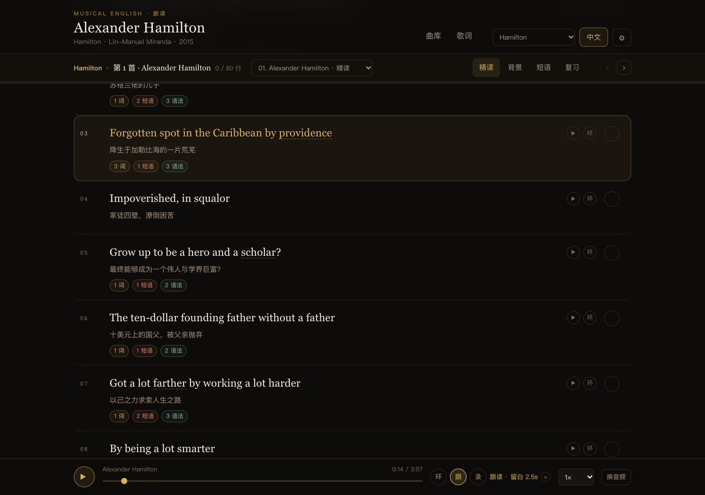

# 剧读 · Musical English

线上：<https://shenziche-afk.github.io/musical-english/>（只读、个人学习用）

**这是什么**：一个给音乐剧爱好者做的英语精读站。每首歌拆成四层——逐行中文讲解（语法 / 词汇 / 短语）、英文历史背景与阅读题、可搜索的短语库、按间隔重复排期的复习卡。

**怎么用**：打开网址 → 右上角选剧目 → 点一首歌 → 顶部四个子页「精读 / 背景 / 短语 / 复习」。手机上可以「添加到主屏幕」；音频按需加载，不会一次下完整部剧。

**数据在哪**：学习进度存在你自己的浏览器（`localStorage`），不上传服务器；换设备不跟，设置页可以导出 / 导入 JSON。



## 现在有什么

| 剧目 | 曲目 | 精读 | 背景卡 | 阅读题 | 音频 |
| --- | --- | --- | --- | --- | --- |
| Hamilton（2015） | 46 | 46 / 46 | 154 | 308 | 98 MB，单声道 96 kbps |
| The Phantom of the Opera（1986 原伦敦卡司） | 21 | 21 / 21 | 50 | 100 | 46 MB，单声道 64 kbps |

合计 **67 首、4,625 行逐行讲解、204 张背景卡、408 道阅读题、395 条参考来源**；歌词全部英中对照，逐句可单独播放。



## 版权与使用

本项目**仅用于个人英语学习，请勿商用、请勿再分发**。歌词、录音、剧照等版权归 Lin-Manuel Miranda、Atlantic Records 及相关权利人所有；本项目不主张相关权利，也未获得授权。

如有侵权，请联系 **shenziche@gmail.com**，核实后 48 小时内下架。完整声明见 [NOTICE.md](NOTICE.md)。

站点底部和设置页都带这段声明，`index.html` 加了 `noindex`；要更强隔离就用 `DEPLOY.md` 里的 Cloudflare Access / Tailscale。

## 打开（音频必须走本地服务）

- **Windows**：双击 `start.bat`。
- **Mac**：双击 `start.command`（第一次可能要在终端跑一次 `chmod +x start.command`）。
- 终端会打印两个地址：`http://127.0.0.1:8765/`（本机）和 `http://192.168.x.x:8765/`（手机/平板，需同一 Wi-Fi）。
- **手机**：和电脑连同一个 Wi-Fi，用手机浏览器打开第二个地址。iPhone 的 Safari / Chrome 都能用；布局已适配窄屏。
- 只想本机访问：`python3 server.py --local`。

不要直接双击 `index.html`：Chrome / Edge / iOS 在 `file://` 下会拦截音频（错误码 4），文字能看，歌放不了。`start` 脚本就是用 Python 起一个本地 HTTP 服务绕开这个限制；拖动进度条也依赖它。

第一次启动时，macOS / Windows 可能弹防火墙提示，允许 Python 访问「专用网络」即可；手机连不上时先检查两台设备是否在同一 Wi-Fi。

## 以歌曲为单位

导航分三层：**剧目 → 曲目 → 学习/复习**。

- **剧目**：右上角下拉切换整部音乐剧（Hamilton / 歌剧魅影）；切换是整页重载。
- **曲目**：顶部「曲库」是 46 首的全剧列表。进入一首歌后，顶部会固定一条 `剧目 › 第 N 首 · 曲名` 的面包屑，旁边是**全剧曲目下拉**——切歌不用回曲库。
- **学习/复习**：曲目页子导航 `精读 · 背景 · 短语 · 复习`，四块都是这首歌自己的内容；另有 ‹ › 切相邻曲目。

- **曲库**：点 ▷ 播放；点行时有「精读」的进精读，其余看歌词。
- **按需加载**：首屏只预载第一首的 pack，打开别的曲目时才注入 `content/<剧目>/<曲目 id>.js`；46 首不会一次性全下（首屏脚本从 2.4 MB 降到约 0.6 MB）。
- 精读和歌词里**每句左侧都有 ▶**，只播这一句（用逐行时间轴，播到句尾自动停）；旁边的「环」是这句的单句循环。
- **歌词跟唱**：播放时高亮当前唱到的那句，并自动滚到屏幕中间。

## 加一部新剧目

每部剧是一个独立文件夹，放在 `content/<id>/` 下：

```
content/
├─ shows.js                 ← 由 build_shows.py 自动生成
├─ hamilton/
│  ├─ show.json             ← 剧目信息 + 要加载的文件列表
│  ├─ tracks.js             window.MUSICAL_TRACKS["hamilton"]
│  ├─ lyrics.js             window.MUSICAL_LYRICS["hamilton"]
│  ├─ times.js              window.MUSICAL_TIMES["hamilton"]
│  └─ alexander-hamilton.js window.MUSICAL_SONGS["alexander-hamilton"]（带 showId）
└─ <新剧 id>/
   ├─ show.json
   └─ ...
audio/<新剧 id>/             ← 音频也按剧目分文件夹
```

步骤：

1. 建 `content/<新剧 id>/show.json`，写 `id / title / subtitle / files`（files 列出要加载的 js）。
2. 放好 `tracks.js`、`lyrics.js`、`times.js`，以及带 `showId` 的精读 pack；音频放 `audio/<新剧 id>/`。
3. 跑一次 `python dev/build_shows.py`，它会扫描 `content/<id>/show.json` 生成 `content/shows.js`。
   pack 文件名必须等于它的 `id`（按需加载按 `content/<剧目>/<id>.js` 取文件）。
4. 刷新页面，右上角下拉里就会出现这部剧。

切换剧目是整页重载（`?show=<id>`），不同剧目的数据互不干扰。

主题色：`show.json` 里可以写 `theme`（一组 CSS 变量，见 `SHOWS.md`），切剧目时整站配色跟着换——Hamilton 是黄铜金，歌剧魅影是黑蓝。

## 四个子页

| 子页 | 做什么 |
| --- | --- |
| **精读** | 逐行讲解；带注释的行展开语法、词汇、短语、节奏；每行左侧 ▶ 只播这一句、「环」单句循环。右侧 ✓ 标记「已掌握」。 |
| **背景** | 英文历史故事（记叙文）。生词带下划线，点一下查中文；读完做 2 道高考式选择题，选完给解析。每篇底部附权威参考链接。 |
| **短语** | 本曲短语卡片，按类型筛选、可搜索、可跳回原句。 |
| **复习** | 词汇/短语：看词选义四选一；语法：翻面后四档自评。SM-2 简化排期。 |

复习快捷键：词汇/短语 `1`–`4` 选答案、`空格` 看答案；语法 `空格` 翻面、`1`–`4` 评分。

## 精听：单句循环与跟读

播放器底部多了三个键，都对着「当前这一句」（先在句子上点 ▶ 或「环」）：

| 键 | 做什么 |
| --- | --- |
| **环** | 单句循环。这一句播完立刻回到句首重放，直到再点一次。状态条会显示已经转了几圈。 |
| **跟** | 跟读。每句播完自动静音留白（默认 2.5 秒，设置页可调 1.5–5 秒），倒计时结束再重放这一句，中间那段空档就是你跟着说的时间。 |
| **录** | 录音回放。点一下开始录，再点 ■ 停止，然后点「听」回放刚才那一遍。录音只留在内存里，刷新即丢，也不会上传。 |

- 跟读模式下点任意一行的 ▶，会自动沿用跟读（一句一句往下走），适合整段过。
- 播放速度（0.5×–1.5×）对循环和跟读都生效：调慢以后留白时间不变，方便先慢速跟一遍。
- 键盘：`R` 循环当前句、`S` 跟读、`Esc` 停；手机上再点一次点亮的键即可退出。
- 录键需要 https 或 localhost 才能拿到麦克风；不支持的浏览器里这个键不显示。

 

左：单句循环第 3 句，底部状态条显示已经转了 1 圈。右：跟读模式下句尾静音，底部倒计时留在「留白 2.5s」。

## 本地工作台（改内容用）

内置页面只能读；想改断句和译文，跑本机工作台：

```bash
python3 dev/studio.py        # 或双击 start-studio.command
```

它只监听 `127.0.0.1`，每个写请求都要启动时打印的令牌，`studio/` 也不进 `dist/` —— 线上那份没有后台，
谁也改不了。三个页签：

| 页签 | 能改 |
| --- | --- |
| **断句** | 每句起止时间：`±0.05 / ±0.1` 微调，或「起点=现在 / 终点=现在」直接把播放位置写成边界；重叠、压句、零长度会红字提示。 |
| **精读** | 译文、注释、节奏提示、词条释义、短语例句、语法讲解、分区标题。 |
| **背景** | 背景卡中英标题与正文、生词释义、阅读题题干/选项/答案/解析。 |

保存是**定点改写**：只替换改过的值，`git diff` 只有那几行；写盘前自动备份到 `dev/_backup/`，
写完立刻跑 `node --check` + `validate_packs`，不过就自动回滚。顶栏「发布」= 校验 → smoke → 提交 → 推送 →
触发 `pages.yml`。细节和坑见 [STUDIO.md](STUDIO.md)。

## 数据存在哪

学习进度、阅读题作答都存在浏览器 `localStorage`（键名 `musical-en.v1`），每答一题就写一次，刷新不丢，换设备不跟；每答一题自动保存；精读页底部和「复习完成」页有**保存**按钮：存一份当天存档（保留最近 7 天）并同时下载 `musical-english-<日期>.json`，设置页可以一键恢复。阅读题记的是选项的原始下标（`曲目:卡片:题号`），所以选项顺序打乱后也不会串答案。设置页（右上角 ⚙）可以**导出 / 导入进度 JSON**。

## 背景故事的写法

每篇按记叙文组织，尽量讲清一个历史事件：

- **场景**：时间、地点、谁在场
- **冲突**：他想要什么，什么挡着他
- **转折**：那件事改变了什么
- **结局**：留下什么，和这首歌有什么关系

`kind: "story"` 是历史故事，`kind: "craft"` 是创作手记（讲写法，不是事件）。

背景只保留英文，不再放整段中文翻译。`glossary` 里的词会在正文中自动加下划线，悬停/点击显示中文；要扩大可查词范围，往 `glossary` 里加 `{ w, zh }` 即可。

## 目录

```
musical-english/
├─ start.bat             双击启动本地服务（Windows，音频必需）
├─ start.command         双击启动（macOS）
├─ start-studio.command  双击启动本地工作台（改内容用，只有本机能用）
├─ server.py             静态服务器，带 Range 支持（可拖进度条）
├─ index.html
├─ assets/app.css
├─ js/core.js            存储、SRS、文本归一化
├─ js/app.js             曲库 / 歌词 + 本曲模块 + 播放器
├─ content/
│  ├─ shows.js            剧目清单（build_shows.py 生成）
│  ├─ poto/               歌剧魅影：tracks / lyrics / times（build_poto.py 生成）
│  └─ hamilton/
│     ├─ show.json            剧目信息 + 文件列表
│     ├─ tracks.js            46 首曲目清单
│     ├─ lyrics.js            46 首歌词 + 中文对照
│     ├─ times.js             46 首逐行时间轴（起止秒）
│     ├─ <song>.js            46 个 pack，每首一个（逐行讲解 + 背景 + 短语）
│     └─ PACK_SPEC.md         pack 写作规范（逐行讲解、背景、来源、校验）
├─ audio/hamilton/       46 首 m4a（单声道 AAC 96k，约 98 MB）
├─ studio/               本地工作台页面（不进 dist）
├─ dev/
│  ├─ studio.py          本地工作台服务：/api 读写 content，只绑 127.0.0.1 + 令牌
│  ├─ jsonedit.py        JSON 定点改写引擎（只替换改动过的值，diff 只有那几行）
│  ├─ build_lyrics.py    从歌词 txt 重新生成 lyrics.js（源文件不随包，跑时给路径）
│  ├─ build_lrc.py       抓取 LRC 并生成 times.js
│  ├─ build_shows.py     扫描 content/<id>/show.json 生成 shows.js
│  ├─ new_show.py        新建剧目脚手架（python3 dev/new_show.py <id> "标题" "副标题"）
│  ├─ build_poto.py      从本地专辑目录生成 poto 的歌词 / 时间轴 / 曲目
│  ├─ clean_credits.js   清歌词末尾的制作名单（node dev/clean_credits.js <id>）
│  └─ smoke.js           Node 冒烟测试
├─ NOTICE.md             版权与下架声明（页面底部、设置页共用同一段文案）
├─ STUDIO.md             本地工作台：改断句 / 译文 / 背景，保存与发布
├─ SHOWS.md              多剧目数据契约与新增剧目流程
├─ HANDOFF.md            交接文档：现状、命令、坑与下一步
├─ DEPLOY.md             部署方案：Cloudflare Pages / Netlify / GitHub Pages
├─ _headers              Cloudflare/Netlify 响应头（noindex、音频 MIME 与缓存）
├─ netlify.toml          Netlify 接 Git 时的构建配置
└─ README.md
```

跑测试：`node dev/smoke.js`（歌词/音频/时间轴、切曲、下一首、逐句播放、背景英文与查词、阅读题、四选一复习、歌词导入）。
内容校验：`node dev/validate_packs.js`（所有 pack 的行数/逐行讲解/分区/背景/题目/来源）。
接入新 pack：`node dev/integrate_packs.js`（自动更新 show.json 与 tracks.js 的 content），再跑 `python dev/build_shows.py`。
写作规范：`content/hamilton/PACK_SPEC.md`。
新增剧目：`python3 dev/new_show.py <id> "Title" "Subtitle"`，细节见 `SHOWS.md`。
部署：见 `DEPLOY.md`（先走 GitHub Pages，push 即自动构建；需要私有仓库或更大带宽再换 Cloudflare Pages）。

## 已知边界

- 行内「相关背景」是作者手挂的，全站只有 5 处；精读页底部另有「本曲背景阅读」入口，列出这首歌全部背景卡，点了直接跳到对应卡片。
- 精读 46 / 46 首全部完成（3416 行）；曲库所有曲目都能进精读。
- 歌剧魅影：21 首精读全部完成（1,209 行讲解、50 张背景卡、100 道阅读题），曲库全部可进精读。
- 逐句时间轴来自网易云 LRC 并对齐到现有歌词；第 2 首有 5 句短感叹是用相邻时间补齐的，可能有零点几秒误差。单句循环的收尾点就按这份时间轴走，误差会直接体现在听起来「多切」或「少切」半拍上。
- 阅读题每篇 2 道；后续曲目同步写英文故事和题目。
- 背景查词只覆盖每篇的生词表，不是全文词典。
- 没有演唱评分，按当前优先级后置。

## 下一步

- 第三部剧：音频、歌词、时间轴、pack 按 `SHOWS.md` 的流程接入
- 背景卡的整篇改写（工作台现在按字段改，还不能整段替换）
- 音频上对象存储或 CDN，进一步缩短手机首播等待
- PWA：外壳与文本离线缓存

## 投喂

如果这个项目对你有帮助，欢迎投喂 🥺 我会继续努力更新。完全自愿，不影响任何功能。


微信扫码 · 感谢投喂
